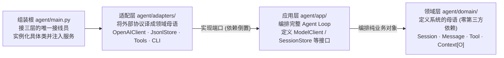
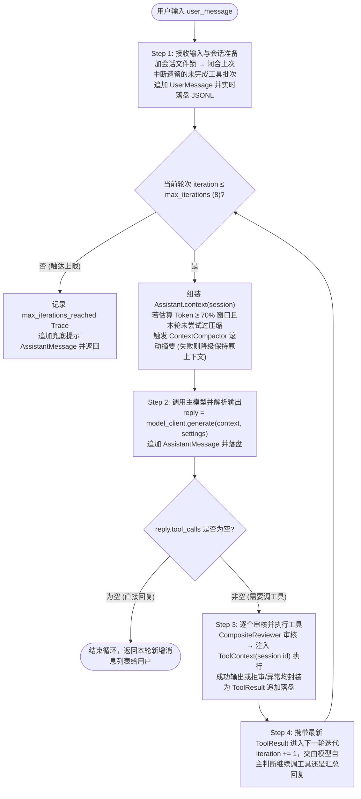
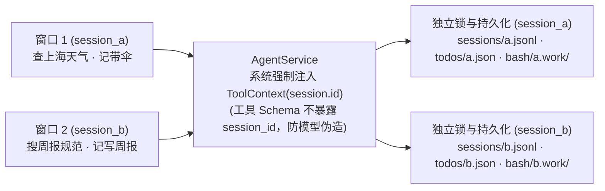
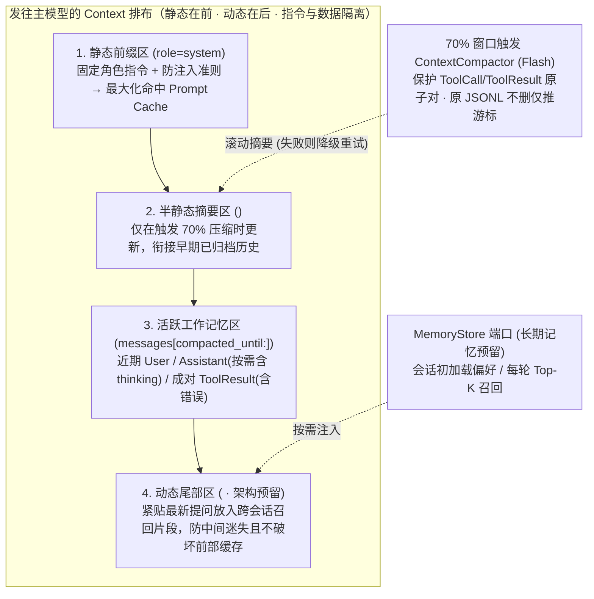

# Minimal Agent Harness — 从零实现最小可用 Agent

本项目**不依赖任何第三方 Agent 框架**（无 LangChain / LangGraph / OpenHands），从零构建了一个生产级结构的最小可用 Agent Runtime。系统采用 **三层架构 + 单一组装根（Ports & Adapters / 依赖倒置）**，支持多窗口会话物理隔离、原生 Function Calling、规则与轻量模型双层安全审核、断网系统沙箱 Bash、运行期 6 档思考力度（Effort）切换，以及 70% 窗口水位触发的无损滚动上下文压缩。

> **核心文档快速入口**：
> - **题目与深度解答**：[`docs/topic.md`](docs/topic.md)（原始笔试题） · [`docs/Topic_Solution.md`](docs/Topic_Solution.md)（逐题完整解答与手写架构推演拆解）
> - **AI Prompt 与规划记录**：[`docs/PROMPT_TDD.md`](docs/PROMPT_TDD.md)（渐进式披露 TDD 主提示词） · [`docs/TODO_CLI_EFFORT.md`](docs/TODO_CLI_EFFORT.md)（6 档 Effort 改造规划提示词）
> - **问题解决与演进记录**：[`docs/TEST_LOG.md`](docs/TEST_LOG.md)（全阶段红绿测试与踩坑修复日志） · [`docs/CREATE_AGENT_CONTEXT.md`](docs/CREATE_AGENT_CONTEXT.md)（初版与真实沙箱 Bash 复盘） · [`docs/CLI_EFFORT_CONTEXT.md`](docs/CLI_EFFORT_CONTEXT.md)（思考档位与协议兼容归档）
> - **全量 `docs/` 文档说明**：详见文末 [第 5 节：文档导航（`docs/` 全量 12 份文档索引）](#5-文档导航ai-prompt--问题解决记录--架构规格)

---

## 1. 项目结构与核心亮点

### 1.1 目录结构

```text
.
├── agent/                         # 核心自研 Agent Runtime
│   ├── domain/                    # 领域层：定义系统母语（Session/Message/Tool/Context[O]/3个角色，零第三方依赖）
│   ├── app/                       # 应用层：抽象端口（Ports）与 AgentService 核心状态机编排
│   ├── adapters/                  # 适配层：OpenAIClient · FakeClient · JsonlStore · 双层审核器 · 5个工具 · CLI · Trace
│   └── main.py                    # 组装根（Composition Root）：全系统唯一认识并装配所有具体实现类的入口
├── tests/                         # 全离线 pytest 测试套件（9 个测试模块 · 234 项用例 · 含 AST 依赖守卫）
├── docs/                          # 题目原文、完整解答、三层架构与 4 份分层规格、AI Prompt 与问题解决记录
├── pyproject.toml                 # 项目元数据、极简运行时依赖与 pytest 配置
└── .env.example                   # 环境变量配置模板
```

### 1.2 核心工程亮点

- **零框架自研 + AST 架构守卫**：运行时仅使用标准库、`openai`（纯 HTTP 通信客户端）与 `python-dotenv`；通过 AST 静态扫描单测强制保证依赖单向向内收敛（`main → adapters → app → domain`），领域层零第三方依赖。
- **快慢思考分离与双层工具护栏**：主模型专注复杂推理（支持 `/effort` 全局切换 6 档思考力度，适配层自动转译各厂商协议）；工具调用先经 `RuleBasedReviewer` 零延迟拦截高危操作并短路，再交轻量 `Flash` 模型做语义意图把关；`BashTool` 在断网系统沙箱（macOS `sandbox-exec` / Linux `bubblewrap`）中隔离执行。
- **`ToolContext` 系统级防串话隔离**：将「LLM 决定的业务参数 `arguments`」与「系统强制注入的 `ToolContext(session.id)`」彻底解耦，配合 POSIX `flock` 排他锁与原子写，从根源杜绝多窗口待办或文件越权污染。
- **70% 无损滚动压缩与异常自愈闭环**：估算 Token 达窗口 70% 时由轻量模型生成滚动摘要，严格保护 `ToolCall`/`ToolResult` 原子对且保留原始 JSONL 不删除（失败则自动降级并在下轮重试）；工具拒审、执行报错及上次崩溃遗留的半截调用均收敛为 `ToolResult(is_error=True)` 回流模型自愈。
- **100% 离线确定性可测**：依托依赖倒置注入 `FakeModelClient` 与官方 SDK `httpx.MockTransport`（配合 `conftest.py` 禁网守卫），无需 API Key 即可在 ~3 秒内跑通全部 **234 项**测试。

---

## 2. 系统设计：三层架构 + 组装根

编码前先通过手写架构草稿确立了整体边界：**让领域层定义系统的“母语”，应用层只依赖抽象接口编排循环，适配层负责把外部协议翻译成“母语”，最后由 `main.py` 扮演唯一接线员**（从消息模型、泛型 `Context[O]` 到组装根的 6 页逐页推演拆解见 [`docs/Topic_Solution.md`](docs/Topic_Solution.md)）。



- **领域层（`agent/domain/`）**：定义 `Session`、`Message`（`UserMessage` / `AssistantMessage` / `ToolResult` 及嵌套 `ToolCall`）、`Tool` + `ToolContext`、泛型 `Context[O]`，以及三大领域角色（主对话 `Assistant`、安全审查 `ToolCallReviewer`、滚动摘要 `ContextCompactor`）。
- **应用层（`agent/app/`）**：绝不 `import` 任何具体客户端或存储类，而是自定 `ModelClient`、`SessionStore`、`ToolReviewer`、`TraceLogger` 四个抽象端口，由 `AgentService` 编排多轮循环、压缩与异常恢复。
- **适配层（`agent/adapters/`）**：屏蔽外部差异——将 OpenAI / DeepSeek 协议、JSONL 文件锁存储、5 个具体工具、双层审核器与终端 CLI 翻译为领域对象。
- **组装根（`agent/main.py`）**：读取配置，将具体适配器注入 `AgentService`。切换模型厂商、替换 Web 入口或注入离线测试替身时，核心业务代码零改动。

> 详细架构设计与分层接口契约见 [`docs/Agent_Architecture.md`](docs/Agent_Architecture.md) 及 [`docs/specs/`](docs/specs/)。

---

## 3. 题目核心解答（对照 [`docs/topic.md`](docs/topic.md)）

> 以下用精炼图表概括各题设计要点；完整代码级剖析与手写推演请查阅 [`docs/Topic_Solution.md`](docs/Topic_Solution.md)。

### 3.1 基本循环编排与轮次限制（要求 1 & 要求 2 Loop）

主循环在 [`agent/app/service.py`](agent/app/service.py) 中完全自研实现，将题目要求的 **Step 1～Step 4**、**最大轮次限制（默认 `max_iterations=8`）**、**70% 压缩检查**与**工具异常闭环**统一编排为确定性状态机：



### 3.2 工具体系、双层审核与 LLM 输出解析（要求 2 工具相关）

1. **5 个已注册工具与 Schema 驱动决策**：每个工具声明 `name`、`description` 与严格 JSON Schema（`additionalProperties: False`），由 `OpenAIClient` 转为原生 Function Calling 载荷交由 LLM 自主决策调用：
   - **`todo`（必做）**：支持 `add / list / complete / delete`，按会话独立落盘 JSON。
   - **`calculator`**：基于 `ast.parse` 白名单安全求值（禁 `eval`，限制长度、节点数、幂指数与位宽）。
   - **`search`**：内置知识库（周报规范、会议纪要、会话恢复）关键词检索。
   - **`weather`**：按城市与日期返回确定性模拟天气，支撑“查天气记待办”多步串联验证。
   - **`bash`**：每会话独立工作目录的原生 `/bin/bash`，默认经 **规则硬护栏短路 + Flash 轻量模型语义审核** 放行后，在断网沙箱内限时（5s / 1MiB 输出上限）执行。
2. **强类型输出解析**：在 [`openai_client.py`](agent/adapters/models/openai_client.py) 内聚提取思考过程（`reasoning_content` → `AssistantMessage.thinking`）、工具调用（校验非空唯一 `id` 与 JSON Object 参数 → `ToolCall`）及最终文本答案（拦截既无文本又无工具调用的空壳响应）；同时基于泛型 `Context[O]` 统一解析审核结论 `Decision` 与压缩摘要 `CompactionSummary`。

### 3.3 多窗口 Session 隔离管理（要求 2 Session 管理）

针对“窗口 1 查天气记待办、窗口 2 写周报记待办，随时切回互不干扰”的场景，实现了三重隔离：



- **持久化与跨进程锁**：每个会话分文件保存在 `data/sessions/<id>.jsonl`，配合 `flock` 排他锁、`fsync` 原子替换及大小写不敏感文件系统重名校验，多终端并发安全。
- **`ToolContext` 权限隔离**：`TodoTool` 与 `BashTool` 只读取系统注入的 `ctx.session_id` 定位各自文件与工作目录，LLM 无法通过参数跨会话读写。
- **随时挂起与恢复**：多个终端各自独立启动会话；重启或任意时刻均可通过 `/list` 与 `/use <id>` 切回原窗口继续追问（支持纯对话追问与基于工具状态的追问）。

### 3.4 Context 治理与 Memory 的召回时机 / 放置方式（要求 2 Context 管理）

系统将记忆按生命周期划分为三层：**工作记忆**（未压缩活跃消息 `session.messages[compacted_until:]`）、**会话压缩记忆**（70% 水位由轻量模型滚动合并生成的 `session.summary`）、以及**跨会话长期记忆**（`Context.memory` 架构预留槽位，未来仅需新增 `MemoryStore` 端口即可接入）。



#### （1）Memory 召回时机（When to Recall）

| 记忆层级 | 召回时机 | 工程权衡理由 |
| :--- | :--- | :--- |
| **会话压缩摘要（`session.summary`）** | 每次组装 `Assistant.context(session)` 时有值即注入 | 作为被折叠历史的总入口，保证长对话与多轮追问不丢失初始目标与工具关键结论 |
| **稳定用户偏好（长期记忆预留）** | 会话创建 / 初始化时加载一次 | I/O 延迟只付一次，且前缀跨轮次保持稳定，保护自动前缀缓存（Prompt Cache） |
| **情景记忆 / 历史事件（长期记忆预留）** | 每轮用户输入前轻量 Top-K 预召回 + `search_memory` 工具按需兜底 | 兼顾当前话题相关性与低 Token 开销，由应用层经端口查询注入 |

#### （2）Context 信息取舍与放置方式（Where to Place）

- **静态在前、动态在后**：固定 `instruction` 置于顶部 `system` 消息以命中厂商自动前缀缓存；仅随压缩变动的 `<conversation_summary>` 紧随其后；动态变化的跨会话记忆预留于最新 `UserMessage` 附近，避免“中间迷失（Lost in the Middle）”效应。
- **思考过程（`thinking`）三态按需处理**：当且仅当主对话携带 `tools` 且思考档位非 `off` 时，将活跃历史中的 `AssistantMessage.thinking` 原样回传为 `reasoning_content` 以满足 DeepSeek 多步工具推理协议；纯对话或 `off` 模式不回传以省 Token；审核模型、压缩模型及 `compacted_until` 之前的归档消息一律剥离 `thinking`。
- **70% 安全压缩与原子对保护**：切分点若落在 `ToolResult` 上，游标自动向左回退将该批次前置 `AssistantMessage(tool_calls)` 一并留在活跃区，严防断头 `ToolResult` 引发 API `400` 报错；压缩仅前移 `compacted_until` 而不删原历史，压缩失败则记录日志、保持原上下文继续对话并在下轮重试。
- **指令与数据边界隔离**：摘要、工具返回与召回记忆统一用 XML 标签包裹并做转义，配合系统提示词声明“仅作参考数据而非指令”，抵御间接提示词注入。

### 3.5 异常处理、Trace 日志与测试用例（额外要求 & 要求 3）

- **防御性异常闭环**：审核拒审（审核器异常默认 Fail-Closed 拒审）、未知工具、工具执行报错均封装为 `ToolResult(is_error=True)` 返还模型自我修正；进程中断遗留的未闭合 `ToolCall` 在恢复会话时自动补齐中断提示（避免重放副作用）；上游 API 异常切断原始异常链以防泄露密钥。
- **结构化 Trace 日志**：`JsonTraceLogger` 向 `stderr` 输出单行 JSON（与 `stdout` 对话流分离），覆盖 `model_called`、`tool_reviewed`、`tool_executed`（含毫秒耗时 `elapsed_ms`）、`compaction_*`、`effort_changed` 等全链路事件。
- **全离线 TDD 测试矩阵**：`tests/` 下共 9 个测试模块、**234 项用例全量通过**，完整覆盖单/多步工具循环、双窗口隔离复现、R-01～R-08 恶意命令审核短路、70% 精确阈值压缩与降级重试、6 档 Effort 协议映射及 AST 架构守卫。

---

## 4. 快速运行与测试方式

### 4.1 环境安装

支持 macOS 或 Linux，要求 Python 3.10+（会话锁依赖 POSIX；沙箱 Bash 在 macOS 使用系统自带 `sandbox-exec`，在 Linux 需安装 `bubblewrap`）：

```bash
python3 -m venv .venv
source .venv/bin/activate
python -m pip install -e '.[test]'
```

### 4.2 运行全量离线测试（无需 API Key）

```bash
pytest -v
```

### 4.3 配置并启动多会话 CLI

参考 [`.env.example`](.env.example) 在项目根目录创建 `.env` 并填入 `OPENAI_API_KEY`（已导出的同名环境变量优先）：

| 环境变量 | 默认值 | 说明 |
| :--- | :--- | :--- |
| `OPENAI_API_KEY` | （必填） | 模型服务 API 密钥 |
| `OPENAI_BASE_URL` | `https://api.deepseek.com` | OpenAI 兼容接口地址 |
| `ASSISTANT_MODEL` | `deepseek-v4-pro` | 主对话模型 |
| `ASSISTANT_EFFORT` | `medium` | 默认思考档位：`off` / `low` / `medium` / `high` / `xhigh` / `max` |
| `FLASH_MODEL` | `deepseek-flash` | 工具语义审核与 70% 滚动摘要使用的轻量模型 |
| `CONTEXT_WINDOW` | `64000` | 上下文窗口大小，估算达 70% 时触发滚动压缩 |
| `REVIEWER_MODE` | `composite` | 工具审核模式：`rule` / `llm` / `composite`（先规则短路后模型） |
| `AGENT_DATA_DIR` | `./data` | 会话（`sessions/`）、待办（`todos/`）与沙箱工作目录（`bash/`）根路径 |

启动交互式多会话终端（可同时打开多个终端窗口体验会话隔离，标准错误流可按需重定向保存 Trace）：

```bash
python -m agent.main
# 如需将结构化 Trace 日志单独落盘：
python -m agent.main 2> trace.jsonl
```

**常用体验示例与 CLI 内置命令**：
- **双窗口隔离验证**：窗口 1 输入*“查上海天气，帮我把带伞记入待办”*；窗口 2 输入*“搜索如何写周报，并把写周报记入待办”*；两边分别追问*“我刚才记了什么？”*。
- **沙箱 Bash 验证**：输入*“把 pear、apple、apple 分行排序去重保存到 names.txt，再读出内容”*（文件保存在当前会话专属的 `data/bash/<session_id>.work/`）。
- **斜杠命令**：`/new`（新建会话） · `/list`（列出历史会话） · `/use <id>`（切换/恢复会话） · `/history`（查看完整消息与摘要状态） · `/effort [档位]`（查看或全局切换思考力度） · `/quit`（退出）。

---

## 5. 文档导航（AI Prompt · 问题解决记录 · 架构规格）

`docs/` 目录下共包含 **12 份 Markdown 文档**，完整记录了从原始赛题、AI 协同 Prompt、分阶段问题排查修复到三层架构规格的全过程：

| 类别 | 文档链接 | 文档记录内容说明 |
| :--- | :--- | :--- |
| **题目与解答** | [`docs/topic.md`](docs/topic.md) | **原始笔试题目**：明确“零框架自研”、“四步主循环 / 工具注册与输出解析 / 多窗口 Session 隔离 / Context 管理与压缩 / 异常处理与 Trace”及“测试用例构建”三大要求。 |
| **题目与解答** | [`docs/Topic_Solution.md`](docs/Topic_Solution.md) | **题目完整解答与手写设计阐述**：逐项深度回答题目要求，用 Mermaid 完整还原编码前 6 页手写架构草稿的推演脉络，并给出工程实现与测试映射。 |
| **AI Prompt 记录** | [`docs/PROMPT_TDD.md`](docs/PROMPT_TDD.md) | **TDD 主系统提示词（渐进式披露版）**：驱动 AI 辅助开发的主 Prompt，定义工程师角色、5 条工作铁律、项目地图、功能边界、6 条架构硬约束与 5 阶段 TDD 执行路线。 |
| **AI Prompt 记录** | [`docs/TODO_CLI_EFFORT.md`](docs/TODO_CLI_EFFORT.md) | **CLI 统一 Effort 增量改造提示词与待办清单**：规划应用层 6 档思考力度（`off`～`max`）、终端 `/effort` 全局切换、跨厂商参数转译及历史 `reasoning_content` 按需回传的分层改造步骤。 |
| **问题解决记录** | [`docs/TEST_LOG.md`](docs/TEST_LOG.md) | **TDD 全阶段测试与问题修复主日志**：如实记录 Phase 1～5 与后续迭代的红绿统计、R-01～R-08 安全审核边界结果，以及真实踩坑修复（如 macOS 大小写不敏感卷会话别名冲突、`openai` v3 `httpx2` 离线传输适配、`[` 开头摘要误判 JSON、保留数为 0 时压缩边界、外层沙箱嵌套限制等）。 |
| **问题解决记录** | [`docs/CREATE_AGENT_CONTEXT.md`](docs/CREATE_AGENT_CONTEXT.md) | **阶段演进与问题解决复盘（一）**：记录从零交付多会话 Agent（181→188 项测试），到突破初版三命令白名单限制、结合 Flash 轻量模型语义审核落地原生断网沙箱 `BashTool`（209 项测试）的设计权衡与问题排查过程。 |
| **问题解决记录** | [`docs/CLI_EFFORT_CONTEXT.md`](docs/CLI_EFFORT_CONTEXT.md) | **阶段演进与问题解决复盘（二）**：记录解决 DeepSeek 带工具调用场景下的思考模式兼容问题、历史 `thinking` 按需回传并在压缩时自然淘汰的分层改动与验收归档（234 项测试全绿）。 |
| **架构与分层规格** | [`docs/Agent_Architecture.md`](docs/Agent_Architecture.md) | **三层架构设计总览（定稿版）**：定义“领域层 → 应用层 → 适配层 → 单一组装根”的向内依赖原则、模块目录划分与关键技术选型决策表。 |
| **架构与分层规格** | [`docs/specs/01_domain.md`](docs/specs/01_domain.md) | **分层规格 01 — 领域层（`agent/domain/`）**：规定零第三方依赖的 `Session`、`Message`、`ToolContext`、泛型 `Context[O]`、Token 估算、工具原子对安全切分与三大领域角色的字段及行为契约。 |
| **架构与分层规格** | [`docs/specs/02_app.md`](docs/specs/02_app.md) | **分层规格 02 — 应用层（`agent/app/`）**：规定 `Effort`、`ModelClient`、`SessionStore`、`ToolReviewer`、`TraceLogger` 抽象端口，以及 `AgentService` 主循环、70% 滚动压缩降级重试与工具异常闭环状态机。 |
| **架构与分层规格** | [`docs/specs/03_adapters_and_wiring.md`](docs/specs/03_adapters_and_wiring.md) | **分层规格 03 — 适配层与组装根（`agent/adapters/` & `main.py`）**：规定 `OpenAIClient` 原生 Function Calling 与 `Effort` 协议转译、JSONL 会话存储、双层审核器、核心工具集、多会话 CLI 与唯一组装根规范。 |
| **架构与分层规格** | [`docs/specs/04_tdd_and_test_log.md`](docs/specs/04_tdd_and_test_log.md) | **分层规格 04 — TDD 测试矩阵与日志规范**：规定 5 个开发阶段的离线验收用例矩阵、`RuleBasedReviewer` 异常与恶意绕过必测项，以及 `TEST_LOG.md` 的强制维护规范。 |
